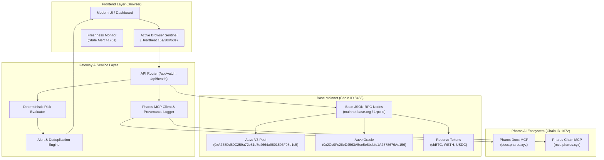

# Architecture & Technical Specification

## 1. Overview & Gateway Pattern

Liquidation Watchdog implements a **Cross-Network Watchdog Gateway** architecture. It monitors active DeFi lending positions on high-liquidity EVM networks (specifically **Aave V3 on Base**, Chain ID `8453`) while integrating into the **Pharos AI Ecosystem** (Chain ID `1672`) via Model Context Protocol (MCP) tooling and local cryptographic provenance ledgers.

---

## 2. On-Chain Contracts & Verified Addresses

### Base Mainnet (Chain ID 8453)

| Contract | Address | Selector / Interface |
| :--- | :--- | :--- |
| **Aave V3 Pool Proxy** | `0xA238Dd80C259a72e81d7e4664a9801593F98d1c5` | `getUserAccountData(address)`: `0xbf92857c` `setUserUseReserveAsCollateral(address,bool)`: `0x5a3b74b9` |
| **Aave Oracle** | `0x2Cc0Fc26eD4563A5ce5e8bdcfe1A2878676Ae156` | `getAssetPrice(address)`: `0xb3596f07` (Base currency USD, 8 decimals) |
| **cbBTC Underlying** | `0xcbb7c0000ab88b473b1f5afd9ef808440eed33bf` | `balanceOf(address)`: `0x70a08231` (8 decimals) |
| **cbBTC aToken** | `0xbdb9300b7cde636d9cd4aff00f6f009ffbbc8ee6` | `balanceOf(address)`: `0x70a08231` (8 decimals) |
| **WETH Underlying** | `0x4200000000000000000000000000000000000006` | `balanceOf(address)`: `0x70a08231` (18 decimals) |
| **WETH aToken** | `0xd4a0e0b9149bcee3c920d2e00b5de09138fd8bb7` | `balanceOf(address)`: `0x70a08231` (18 decimals) |
| **USDC Underlying** | `0x833589fcd6edb6e08f4c7c32d4f71b54bda02913` | `balanceOf(address)`: `0x70a08231` (6 decimals) |
| **USDC Variable Debt** | `0x59dca05b6c26dbd64b5381374aaac5cd05644c28` | `balanceOf(address)`: `0x70a08231` (6 decimals) |

---

## 3. Mathematical Specifications

### 3.1 Aave V3 Health Factor Arithmetic

Aave computes position health factor using exact integer math scaled by $10^{18}$ (WAD):

$$\text{HealthFactor} = \frac{\text{totalCollateralBase} \times \text{currentLiquidationThreshold}}{\text{totalDebtBase}} \times 10^{14}$$

Where:
- $\text{totalCollateralBase}$ is denominated in USD with 8 decimals ($10^8$).
- $\text{totalDebtBase}$ is denominated in USD with 8 decimals ($10^8$).
- $\text{currentLiquidationThreshold}$ is in basis points ($10^4$, e.g. $8400 = 84.00\%$).
- Scaling factor: $\frac{10^8 \times 10^4}{10^8} \times 10^{14} = 10^{18}$ (1 WAD).

### 3.2 Aave Half-Up Integer Debt Rounding

To calculate token balance values in base currency ($10^8$), Aave uses standard half-up integer rounding:

$$\text{valueBase} = \left\lfloor \frac{(\text{balanceRaw} \times \text{oraclePriceRaw}) + \left\lfloor\frac{10^{\text{decimals}}}{2}\right\rfloor}{10^{\text{decimals}}} \right\rfloor$$

For USDC (6 decimals, divisor $10^6$, half $500,000$):
$$\text{remainder} = (\text{balanceRaw} \times \text{oraclePriceRaw}) \pmod{10^6}$$
If $\text{remainder} \ge 500,000$, the base unit increments by $+1$.

### 3.3 Debt Repayment Remediation Formula

To reach target health factor $HF_{\text{target}}$:

$$\Delta D_{\text{USD}} = \max\left(0, D - \frac{C \times LT}{HF_{\text{target}}}\right)$$

$$\Delta D_{\text{tokens}} = \frac{\Delta D_{\text{USD}}}{\text{Price}_{\text{debtAsset}}}$$

- **Token integer representation**: Truncated with floor rounding: $\lfloor \Delta D_{\text{tokens}} \times 10^{\text{decimals}} \rfloor$.

### 3.4 Asset-Specific Collateral Addition Formula

To reach target health factor $HF_{\text{target}}$ using asset $A$ with liquidation threshold $LT_A$:

$$\Delta C_{\text{USD}} = \max\left(0, \frac{D \times HF_{\text{target}} - C \times LT}{LT_A}\right)$$

$$\Delta C_{\text{tokens}} = \frac{\Delta C_{\text{USD}}}{\text{Price}_A}$$

- **Token integer representation**: Rounded upward with ceiling rounding: $\lceil \Delta C_{\text{tokens}} \times 10^{\text{decimals}} \rceil$ to strictly guarantee safety margin.
- **Protocol Guardrail**: If $LTV_A = 0$ (e.g. USDC), $\Delta C_{\text{USD}}$ is not evaluated. The asset is classified as `isEligible: false` with explanation of the on-chain revert invariant `UserHasAssetWithZeroLtv()`.

---

## 4. Active Browser Sentinel & Monitoring Bounds

| Dimension | Specification |
| :--- | :--- |
| **Client Polling Intervals** | Selectable: Manual (0), 15 seconds, 30 seconds (default), 60 seconds. |
| **Client Lifecycle** | Active only while web browser tab is open. Pauses upon tab closure or background suspension. |
| **Stale Data Alarm** | Activates if last successful observation exceeds 120 seconds. |
| **Vercel Hobby Schedule** | Once every 24 hours (`0 0 * * *`) via Vercel Cron. Continuous background monitoring is explicitly disclaimed. |
| **Alert Deduplication** | 10-minute suppression window for alerts when state is unchanged and $|\Delta HF| < 0.01$. |
| **Tamper Evidence** | Local SHA-256 digest calculated for every incoming RPC payload and recorded in session provenance. |
